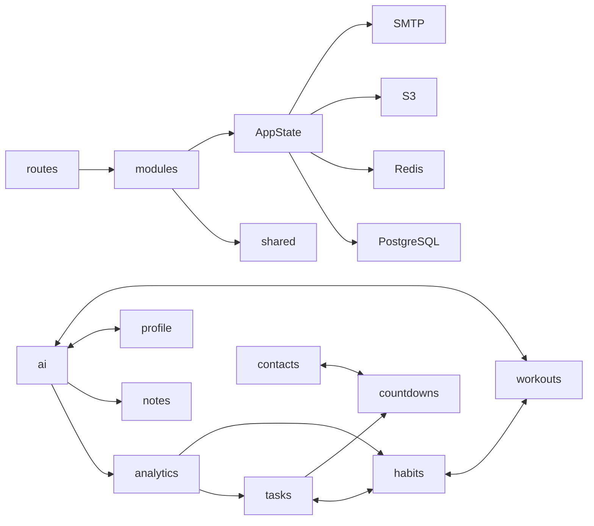

# Организация Rust backend

Аудит от 04.11.2026 охватывает все **52 исходных Rust-файла**: 51 в `src/` и `tests/foundation.rs` (15 164 строки). Назначение и связи установлены по исходникам; Graphify использован для начальной навигации. Схема графа сама по себе не подтверждает поведение.

## Точки входа и границы

```text
src/
  main.rs                   запуск, миграции, завершение
  lib.rs                    публичный API и совместимые переэкспорты
  config.rs                 единая конфигурация окружения
  routes.rs                 композиция маршрутов и порядок middleware
  infrastructure/           PostgreSQL, Redis, S3, SMTP, AppState, health
  shared/                   сессия, ошибки, CSRF, шифрование, расписания, общие helpers
  modules/
    auth/                   вход по email-коду
    tasks/                  задачи, появления, календарь, Gantt
    habits/                 привычки, версии, отметки, статистика
    workouts/               упражнения/планы, preferences/, sessions/, plan.rs
    pomodoro/               таймер и programs/
    contacts/               контакты и политика связанных событий
    countdowns/             отсчёты и привязки контактов
    notes/                  заметки и папки
    boards/                 доски и колонки
    labels/                 метки и functions.rs
    analytics/              сводная аналитика и privacy
    intimacy/               приватный журнал
    profile/                профиль
    settings/               настройки пользователя
    navigation/             порядок разделов
    history/                лента и middleware аудита
    media/                  приватные изображения
    operators/              интеграция поиска оператора
    ai/                     настройки, чаты, запросы, генерация
      access/               права на объекты
      actions/              подтверждаемые предложения
      login/                аккаунты провайдера
      providers/            Responses и Ollama
```

`mod.rs` экспортирует возможности области. `routes.rs` связывает пути с обработчиками; `handlers.rs` адаптирует HTTP; `models.rs`/`dto.rs` содержат прежние типы и serde-контракты. `repository.rs` хранит выделенные операции доступа к данным, `service.rs` — операции предметной области. Там, где это понятнее, используются специальные файлы: `tasks/planning.rs`, `habits/marks.rs`, `habits/statistics.rs`, `pomodoro/programs/runtime.rs`, `ai/generation.rs`.

Внутренние вызовы между областями идут через их фасады и канонические пути `crate::modules::…`. Детали слоёв приватны, доступ соседних файлов ограничен `pub(super)`. Прежние публичные пути `lifecycle_api::{auth, config, crypto, domain, error, habits, profile, schedule, settings, state, tasks, workouts}` и `router` продолжают работать.

SQL перенесён вместе с исходной операцией: часть запросов остаётся в обработчиках и сервисах, где ранее начиналась транзакция. Разделение каждого такого запроса на отдельный repository-метод не выполнялось: это отдельные небольшие изменения с проверкой блокировок. Схема БД, миграции, SQL, Redis-ключи/скрипты, шифровальные контексты, таймауты и порядок middleware сохранены. Не добавлены пустые treasury/health-domain/pagination слои для возможностей, которых в исходном backend нет.

## Общие механизмы

| Владелец | Ответственность |
| --- | --- |
| `config.rs` | Единственный источник настроек окружения и их проверки |
| `infrastructure/state.rs` | Сборка AppState с прежними публичными полями |
| `infrastructure/database.rs` | Lazy pool, прежние лимиты/таймаут и миграции |
| `infrastructure/redis.rs`, `storage.rs`, `mail.rs` | Создание внешних клиентов с прежними параметрами |
| `infrastructure/health.rs` | Реальные проверки PostgreSQL, Redis и Garage |
| `shared/auth.rs` | CurrentUser, проверка сессии, parsing/формирование cookie |
| `modules/auth/handlers.rs` | Запрос/проверка email-кода, выдача сессии и logout |
| `shared/errors.rs` | ApiError, ApiJson и единый ответ об ошибке |
| `shared/csrf.rs`, `crypto.rs` | Origin-защита и AES-GCM |
| `shared/schedule.rs` | Общая работа с повторениями и DST |
| `shared/domain.rs` | Валидация, Search, activity events и локальная дата пользователя |

`shared/domain.rs` по-прежнему читает пользовательские Settings. Это сохранённая зависимость от `modules/settings`; перенос её в новый контекст пользователя потребовал бы отдельного изменения API helpers.

## Карта межмодульных зависимостей

Таблица показывает прямые ссылки из исходных Rust-файлов (включая существующие тесты); общие auth/domain/errors/state опущены. Подмодули тренировок, Pomodoro и AI объединены со своими владельцами. Направление: **вызывающая область → используемые области**.

| Область | Прямые зависимости |
| --- | --- |
| `ai` | `analytics`, `intimacy`, `notes`, `profile`, `tasks`, `workouts` |
| `analytics` | `habits`, `intimacy`, `pomodoro`, `profile`, `tasks` |
| `boards` | `tasks` |
| `contacts` | `countdowns` |
| `countdowns` | `contacts` |
| `habits` | `tasks`, `workouts` |
| `history` | — |
| `intimacy` | — |
| `labels` | `ai`, `contacts`, `intimacy`, `tasks` |
| `media` | — |
| `navigation` | `tasks` |
| `notes` | `tasks` |
| `operators` | — |
| `pomodoro` | `tasks` |
| `profile` | `ai` |
| `settings` | — |
| `tasks` | `countdowns`, `habits`, `labels` |
| `workouts` | `ai`, `habits`, `tasks` |

Сохранены существующие циклы `tasks ↔ habits`, `contacts ↔ countdowns`, `AI ↔ profile/workout preferences` и внутренний `pomodoro ↔ programs`. Tasks использует типы привычек/их появления; привычки используют задачи и блокировку задач. Contacts и countdowns совместно обслуживают дни рождения, unlink и политику удаления. Разрывать эти связи заменой DTO или новой транзакционной моделью в организационном переносе нельзя.



## Полный реестр исходных файлов

Пути слева относятся к состоянию до переноса. Группа файлов справа содержит перенесённые определения; существующие unit-тесты перемещены вместе со своим владельцем.

| Исходный файл | Строк | Назначение | Текущее расположение внутри src/ |
| --- | ---: | --- | --- |
| `src/ai.rs` | 896 | Настройки, права контекста, чаты, preview, запросы и фоновые ответы | `modules/ai/` |
| `src/ai_access.rs` | 194 | Права владельца на передачу отдельных объектов в AI | `modules/ai/access/` |
| `src/ai_actions.rs` | 686 | Проверка, подтверждение, атомарное применение и отмена предложений AI | `modules/ai/actions/` |
| `src/ai_context.rs` | 153 | Сбор разрешённого контекста LifeCycle и ограничения выборки | `modules/ai/context.rs` |
| `src/ai_login.rs` | 784 | Вход к провайдеру, PKCE, проверка JWT, аккаунты и refresh | `modules/ai/login/` |
| `src/ai_provider.rs` | 389 | Responses payload, HTTP/SSE, лимиты ответа и ошибки провайдеров | `modules/ai/providers/responses.rs` |
| `src/analytics.rs` | 531 | Агрегаты задач/привычек/таймеров/тренировок, privacy и AI-отчёт | `modules/analytics/` |
| `src/auth.rs` | 333 | Email-коды, лимиты Redis, пользователи, cookies и проверка сессии | `modules/auth/ + shared/auth.rs` |
| `src/boards.rs` | 482 | Доски, колонки, принадлежность/перенос задач и ревизии | `modules/boards/` |
| `src/config.rs` | 158 | Чтение и валидация переменных окружения без раскрытия секретов | `config.rs` |
| `src/contacts.rs` | 52 | Фасад контактов и существующие unit-тесты | `modules/contacts/` |
| `src/contacts/domain.rs` | 171 | ContactData, нормализация, валидация и поиск дублей | `modules/contacts/domain.rs` |
| `src/contacts/dto.rs` | 43 | Входные данные записи, импорта, удаления и меток | `modules/contacts/dto.rs` |
| `src/contacts/handlers.rs` | 89 | HTTP-маршруты и обработчики контактов | `modules/contacts/handlers.rs` |
| `src/contacts/repository.rs` | 187 | SQL/шифрование контактов и привязка дней рождения | `modules/contacts/repository.rs` |
| `src/contacts/service.rs` | 194 | Транзакции, ревизии, импорт, удаление и метки | `modules/contacts/service.rs` |
| `src/countdowns.rs` | 217 | Фасад отсчётов, календарные появления и unit-тесты | `modules/countdowns/` |
| `src/countdowns/domain.rs` | 195 | Повторения, возраст/остаток времени, даты и категории | `modules/countdowns/domain.rs` |
| `src/countdowns/dto.rs` | 94 | Входные данные отсчётов, nullable-поля и unlink | `modules/countdowns/dto.rs` |
| `src/countdowns/handlers.rs` | 93 | HTTP-маршруты и обработчики отсчётов | `modules/countdowns/handlers.rs` |
| `src/countdowns/model.rs` | 100 | SQL/API-модели, snapshots и календарные события | `modules/countdowns/model.rs` |
| `src/countdowns/repository.rs` | 424 | SQL, сохранение/удаление и зашифрованные снимки контактов | `modules/countdowns/repository.rs` |
| `src/crypto.rs` | 65 | AES-GCM, контекст владельца/записи и проверка целостности | `shared/crypto.rs` |
| `src/csrf.rs` | 37 | Проверка Origin и Sec-Fetch-Site перед изменениями | `shared/csrf.rs` |
| `src/domain.rs` | 97 | Общие проверки, Search, настройки/локальная дата и activity events | `shared/domain.rs` |
| `src/error.rs` | 144 | ApiError, JSON-экстрактор и единый формат ошибок HTTP | `shared/errors.rs` |
| `src/habits.rs` | 882 | Привычки поверх задач, версии, отметки, тренировки и статистика | `modules/habits/` |
| `src/health.rs` | 80 | Liveness и ограниченные по времени реальные readiness-проверки | `infrastructure/health.rs` |
| `src/history.rs` | 192 | Лента/скрытие истории и middleware аудита успешных операций | `modules/history/` |
| `src/intimacy.rs` | 633 | Зашифрованный приватный журнал, валидация дат и статистика | `modules/intimacy/` |
| `src/labels.rs` | 447 | Реестр меток, синхронизация/переименование, ревизии и адаптеры | `modules/labels/` |
| `src/labels/functions.rs` | 247 | Адаптеры функциональных меток: точная стоимость и чтение AI-доступа | `modules/labels/functions.rs` |
| `src/lib.rs` | 106 | Публичные модули библиотеки и композиция Axum router/middleware | `lib.rs + routes.rs` |
| `src/mail.rs` | 55 | Создание SMTP transport и отправка кода с таймаутами | `infrastructure/mail.rs` |
| `src/main.rs` | 69 | Логирование, запуск, миграции, listener и graceful shutdown | `main.rs` |
| `src/media.rs` | 150 | Приватная загрузка/выдача S3, SQL-метаданные и проверка MIME | `modules/media/` |
| `src/navigation.rs` | 123 | Порядок/закрепление разделов и оптимистическая ревизия | `modules/navigation/` |
| `src/notes.rs` | 447 | Папки и заметки, поиск, bulk-операции и транзакционный API для AI | `modules/notes/` |
| `src/ollama.rs` | 85 | Проверка адреса и локальный протокол Ollama | `modules/ai/providers/ollama.rs` |
| `src/operators.rs` | 236 | Настройки провайдера, шифрование ключа, поиск номера и кеш | `modules/operators/` |
| `src/pomodoro.rs` | 227 | Состояние и команды самостоятельного серверного таймера | `modules/pomodoro/` |
| `src/pomodoro_programs.rs` | 581 | Конфигурации/запуски программ, интервалы, восстановление и история | `modules/pomodoro/programs/` |
| `src/profile.rs` | 466 | Зашифрованный профиль, частичное обновление и ревизии | `modules/profile/` |
| `src/schedule.rs` | 342 | Общий календарный движок: повторения, часовые пояса и DST | `shared/schedule.rs` |
| `src/settings.rs` | 272 | Настройки интерфейса/времени/Pomodoro, значения по умолчанию и валидация | `modules/settings/` |
| `src/state.rs` | 59 | Общее состояние и создание PostgreSQL/Redis/S3/SMTP клиентов | `infrastructure/state.rs` |
| `src/tasks.rs` | 1194 | CRUD/иерархия, снимки появлений, Today/calendar и Gantt-планирование | `modules/tasks/` |
| `src/workout_plan.rs` | 395 | Валидация упражнений/планов, прогрессия и снимок шагов тренировки | `modules/workouts/plan.rs` |
| `src/workout_preferences.rs` | 151 | Тренировочные условия/предпочтения и инвалидирование AI-контекста | `modules/workouts/preferences/` |
| `src/workout_sessions.rs` | 389 | Выполнение снимка тренировки, шаги, паузы и завершение привычки | `modules/workouts/sessions/` |
| `src/workouts.rs` | 367 | CRUD упражнений/тренировок, ссылки и транзакционный API для AI | `modules/workouts/` |
| `tests/foundation.rs` | 161 | 7 интеграционных проверок конфигурации, router, health, заголовков и CSRF | `tests/foundation.rs` (без изменений) |

## Проверка переносов

До изменений зафиксирована база: `cargo fmt --check`, `cargo check --locked --offline`, `cargo clippy --locked --offline --all-targets -- -D warnings`, `cargo test --locked --offline`. На базовом и каждом промежуточном этапе проходят **72 unit + 7 foundation**; новых тестов не добавлено. Для существующего HTTP-теста каталога провайдера нужен разрешённый loopback.

| Этап | Перенос | fmt/check/clippy/test + foundation API |
| --- | --- | --- |
| 1 | infrastructure/shared и композиция router | PASS |
| 2 | общая сессия, auth, contacts, countdowns | PASS |
| 3 | tasks и habits | PASS |
| 4 | workouts и pomodoro | PASS |
| 5 | notes, boards, navigation, history, labels | PASS |
| 6 | profile, settings, analytics, intimacy, media, operators | PASS |
| 7 | AI и адаптеры | PASS |

Дополнительное сравнение синтаксического дерева с сохранёнными исходниками подтверждает сохранность **561 функции, 189 структур, 12 enum и всех 430 строковых литералов SQL/API**. Сравнение допускает новые пути модулей, ограниченную видимость и форматирование. Два ожидаемых изменения — `AppState::lazy` и `AppState::migrate`: их прежние операции делегированы `infrastructure/{database,redis,storage,mail}` без смены параметров или порядка инициализации. Существующий `tests/foundation.rs` не изменён.


## Прикладные API-проверки и контроль исходной версии

Обе версии собраны одним `Containerfile`: новая из рабочего дерева, исходная из снимка всех `src/` до переноса. Прогоны выполнены последовательно на отдельной PostgreSQL-базе с новыми синтетическими аккаунтами. Рабочие сервисы не заменялись. Все 29 миграций и SHA-384 их файлов проверены; readiness PostgreSQL/Redis/Garage и приватный S3 upload/download с проверками владельца, MIME и превышения размера проходят.

**Логи и результаты всех 17 наборов побайтно совпадают между двумя сборками:** 8 PASS и 9 существующих несовпадений smoke-сценариев с текущим API. Существующие сценарии не изменялись ради зелёного результата.

| API-набор из scripts/ | Исходная версия | После переноса |
| --- | --- | --- |
| `ai_connections_smoke.py` | PASS | PASS |
| `notes_upgrade_smoke.py` | PASS | PASS |
| `tasks_upgrade_smoke.py` | PASS | PASS |
| `contacts_upgrade_smoke.py` | PASS | PASS |
| `pomodoro_upgrade_smoke.py` | PASS | PASS |
| `profile_upgrade_smoke.py` | PASS | PASS |
| `functional_labels_smoke.py` | PASS | PASS |
| `frontend_workflows_smoke.py` | PASS | PASS |
| `auth_smoke.py` | FAIL | та же ошибка |
| `habits_smoke.py` | FAIL | та же ошибка |
| `workouts_smoke.py` | FAIL | та же ошибка |
| `intimacy_smoke.py` | FAIL | та же ошибка |
| `analytics_smoke.py` | FAIL | та же ошибка |
| `ai_smoke.py` | FAIL | та же ошибка |
| `workspace_upgrade_smoke.py` | FAIL | та же ошибка |
| `countdowns_upgrade_smoke.py` | FAIL | та же ошибка |
| `contact_countdowns_smoke.py` | FAIL | та же ошибка |

Причины первых остановок старых сценариев: `auth_smoke` отправляет неподдерживаемое поле настроек; `habits_smoke` и `workouts_smoke` ожидают завершённые появления в календаре; `intimacy_smoke` использует прежние поля журнала; `ai_smoke` отправляет прежние параметры привычки; `workspace_upgrade_smoke` ожидает старый набор навигации; три сценария countdowns/analytics отправляют произвольные категории вместо enum/`custom:UUID`. Эти расхождения воспроизведены на исходном коде; поведение backend не подгонялось под старые сценарии.

Проверка провайдеров покрывает контракты payload/stream/privacy, ключи и запрещённые OAuth-переходы; реальный внешний AI inference и успешный вход во внешний аккаунт не выполнялись. Временные стенд/база/файл ключей и точные S3-объекты из тестовой базы удалены после проверки.
